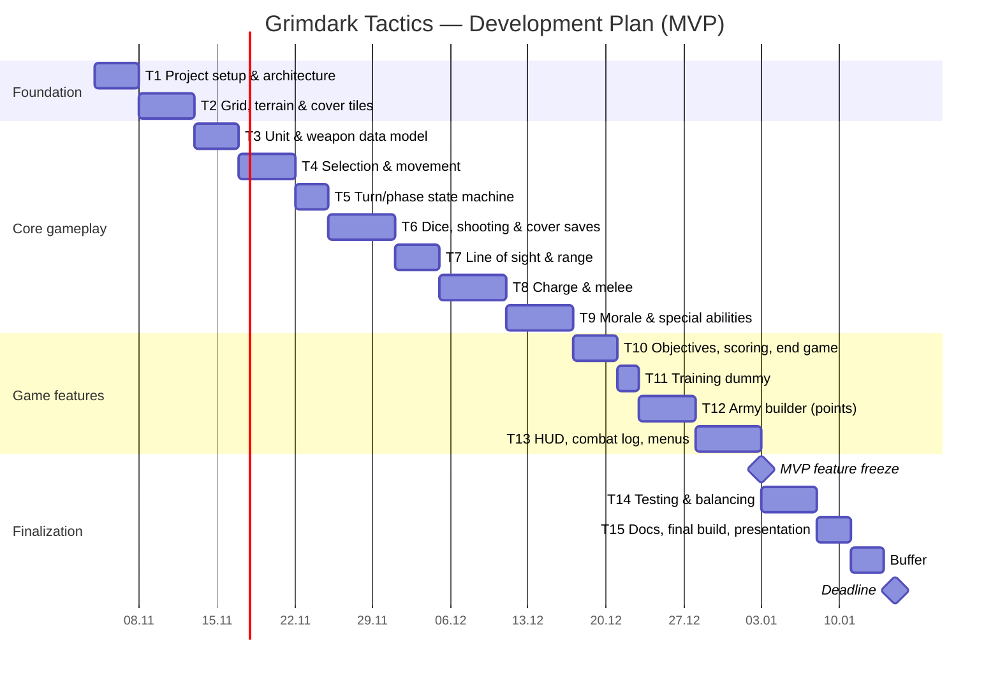

# Grimdark Tactics — Project Specification

## 1. Vision

Grimdark Tactics is a 2D, turn-based tactical wargame inspired by tabletop miniature games. The player commands a squad-based army on a grid battlefield. Each turn is divided into phases (movement, shooting, charge, melee), and combat is resolved with dice rolls (to-hit, to-wound, armor save). Positioning, cover and army composition matter as much as luck. The setting is a dark, gritty sci-fi universe.

In its first version the game works as a **single-player tabletop simulator**: the player faces a passive training dummy that never acts, so every rule of the tabletop game can be tested and played out. Local 2-player mode is the planned next version.

The game is a non-commercial course project. It uses original names, units and assets to avoid copyright issues with the franchise that inspired it.

## 2. Business Requirements

| ID | Requirement |
|----|-------------|
| BR-1 | Deliver a playable, stable game build by the course deadline. |
| BR-2 | Implement the full set of core tabletop mechanics (phases, dice combat, cover, line of sight, morale, special abilities, objectives, points). |
| BR-3 | The first version is single-player: one player army versus a passive training dummy. |
| BR-4 | Player builds an army within a points budget. |
| BR-5 | Game ends with a clear end condition (objectives scored or dummy destroyed). |
| BR-6 | Code is maintainable: data-driven units (Godot `Resource`), game logic separated from UI, so a second player can be added later without a rewrite. |
| BR-7 | Project is documented (README, specification) and versioned on GitHub. |
| BR-8 | Runs on desktop (Windows) with no external dependencies. |

## 3. User Stories

- **US-1** As a player, I want to see a grid battlefield with terrain, so I can plan my moves.
- **US-2** As a player, I want to select a unit and move it within its movement range, so I can position it tactically.
- **US-3** As a player, I want turns split into clear phases, so I always know what actions are allowed.
- **US-4** As a player, I want to shoot enemy units and see dice results (hit, wound, save), so combat feels transparent.
- **US-5** As a player, I want line of sight and weapon range to be enforced, so shooting follows the tabletop rules.
- **US-6** As a player, I want to charge and fight in melee, so I can finish off enemies up close.
- **US-7** As a player, I want cover to improve my units' saves, so terrain matters.
- **US-8** As a player, I want morale checks and special unit abilities, so units behave like on the tabletop.
- **US-9** As a player, I want to capture objectives and score points, so there is more to win than killing everything.
- **US-10** As a player, I want a passive training dummy as the opponent, so I can test mechanics and tactics without being attacked.
- **US-11** As a player, I want to build an army within a points limit, so I can choose my own strategy.
- **US-12** As a player, I want a HUD (current phase, unit stats, combat log) and a result screen with restart, so I understand what is happening and can play again.

## 4. MVP (Minimum Viable Product)

A single-player tabletop simulator with **all core tabletop mechanics** implemented:

- Grid battlefield with obstacles, terrain and cover
- Turn system with phases: movement → shooting → charge → melee
- Units and weapon profiles (range, attacks, strength, damage) defined as `Resource` files
- Pathfinding and movement range (`AStarGrid2D`)
- Line of sight and weapon range
- Dice-based combat: to-hit, to-wound, armor save, wounds and unit removal
- Cover bonus to saves
- Morale checks
- Special unit abilities (a small set of reusable rules)
- Objectives, scoring and end condition
- Army builder with points budget
- **Training dummy** opponent: stands on the battlefield, can be attacked, never acts
- HUD: phase indicator, unit stats, combat/dice log
- Main menu, result screen, restart

## 5. NVP (Next Version Product)

- **Local 2-player mode** (hot-seat): two human players share one screen and alternate turns
  - the passive dummy is replaced by a second player-controlled army
  - turn handover between players (hide/show active player's controls)
  - army builder and deployment for both players
  - win/lose condition for both sides

## 6. Tasks

| # | Task | Related stories |
|---|------|-----------------|
| T1 | Project setup, folder structure, architecture, Git workflow | – |
| T2 | Grid battlefield (TileMap), obstacles, terrain, cover tiles | US-1 |
| T3 | Unit and weapon data model (`Resource`), unit scenes | US-2 |
| T4 | Unit selection and movement with pathfinding | US-2 |
| T5 | Turn/phase state machine | US-3 |
| T6 | Dice system, shooting combat and cover saves | US-4, US-7 |
| T7 | Line of sight and weapon range | US-5 |
| T8 | Charge and melee combat | US-6 |
| T9 | Morale and special abilities | US-8 |
| T10 | Objectives, scoring and end conditions | US-9 |
| T11 | Training dummy opponent | US-10 |
| T12 | Army builder with points budget | US-11 |
| T13 | HUD, combat log, menus, result screen | US-12 |
| T14 | Testing, bug fixing, balancing | all |
| T15 | Documentation, final build, presentation | BR-7 |
| N1 | *(NVP, after deadline)* Local 2-player mode | – |

## 7. Schedule (Gantt Chart)

> The schedule counts calendar days (weekends included): 71 of the 73 days between 4 November and 15 January, ending with a 3-day buffer. The NVP (local 2-player mode) is planned after the deadline. If work slips, reduce the number of special abilities in T9 or simplify T12 (army builder) before touching the core phase/combat loop.
